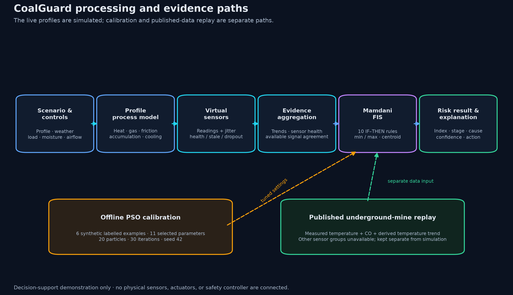
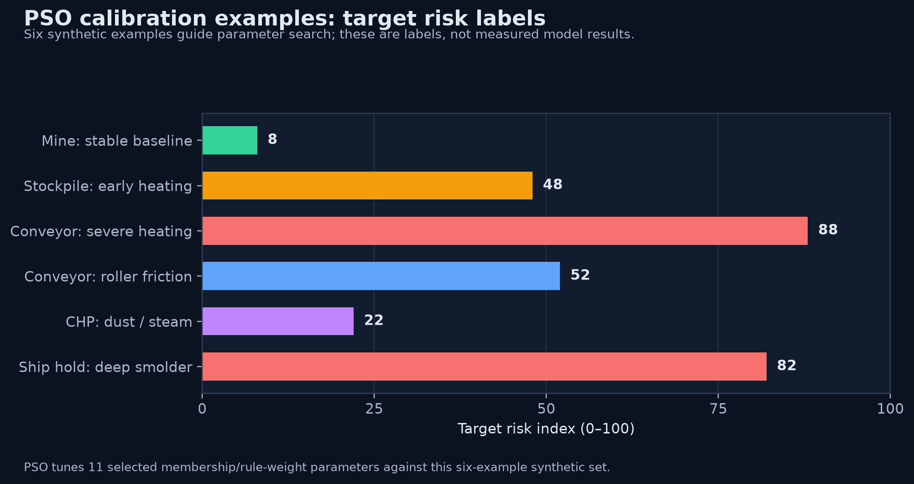
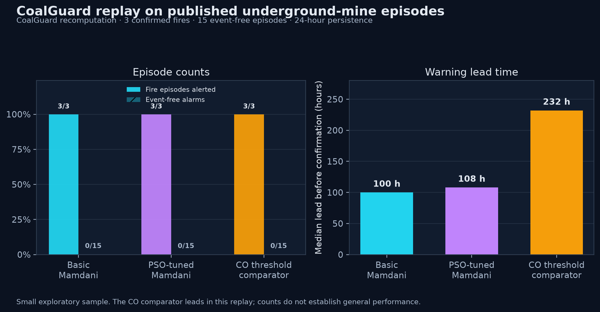
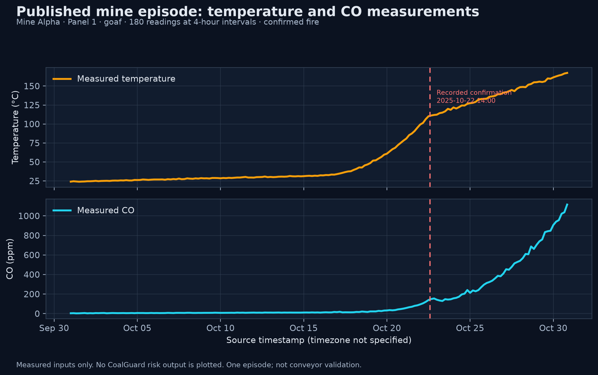

# CoalGuard — Project Information for Academic Presentation

This document is a presentation-oriented source for understanding the current CoalGuard project. It describes the implementation, its data, its results, and its limits. It should be read with the project [README](./README.md), which gives setup and route details.

## 1. Project in one paragraph

CoalGuard is a local academic software prototype for exploring explainable coal-fire risk assessment. It simulates five coal-handling contexts, generates virtual sensor telemetry, models sensor noise and availability faults, aggregates trends and sensor health, and applies a Mamdani Fuzzy Inference System (FIS) to produce a 0–100 risk index, risk stage, likely cause, confidence, active rules, and suggested response. Particle Swarm Optimization (PSO) calibrates selected fuzzy parameters using a small labelled synthetic set. A separate Evidence page replays published underground-mine records. The live process profiles are simulations; the published-data replay is a small exploratory evaluation, not a field trial of the five profiles.

### Project objective

Combine uncertain multi-sensor evidence to identify and explain developing coal-fire risk in a repeatable academic simulator.

### What makes the prototype useful

- Shows the complete path from operating conditions to readings, inference, and an explanation.
- Lets a student change conditions and observe how a modeled process and its sensor signals respond.
- Makes fuzzy memberships, rule activations, confidence factors, and PSO calibration inspectable.
- Includes ten deterministic scenario cases and a separate replay of published underground-mine data.

## 2. The real-world context

Coal can oxidize at relatively low temperatures. If oxidation generates heat faster than the material and surrounding system remove it, the material can warm further and oxidation can accelerate. A hotspot may be hidden inside a stockpile, transfer area, or enclosed cargo space before there is visible flame.

Coal fires can also start through equipment faults. A slipping or misaligned belt, seized roller, or overheated bearing can produce frictional heat near coal, dust, grease, or belt material. The warning pattern may be mechanical before it is a gas or combustion pattern.

CoalGuard represents both kinds of scenario in its simulator. It is a learning and decision-support prototype. It is not an alarm controller, certified safety system, or industrial digital twin synchronized with a real facility.

## 3. The five modeled environments

The profiles share the same general risk engine but have different process models, layouts, operating conditions, and scenario choices.

| Profile | Modeled layout and hazard examples | Virtual sensor types shown in the profile |
|---|---|---|
| **Mine Conveyor** | Underground belt, idlers, drive pulley, and transfer discharge; gradual self-heating, roller friction, blockage | Temperature, CO, vibration, motor current, dust, and thermal inspection context |
| **Factory CHP** | Crusher feed, vibrating screen, enclosed transfer chute, and bunker infeed; chute blockage, hot equipment, dust or spray interference | Temperature, CO, dust, vibration, motor current, and thermal inspection context |
| **Stockpile Yard** | Open-air piles with shallow and deep probes; compacted-core heating and a cool surface hiding a warmer interior | Temperature, CO, humidity, wind, and thermal inspection |
| **Road / Rail Transit** | Selectable truck tipper or rail hopper; heat during dwell, airflow, and vehicle vibration | Temperature, CO, vibration, airflow/wind, and thermal inspection |
| **Ship Cargo Hold** | Enclosed bulk-carrier hold with restricted access; deep smolder, oxygen depletion, and gas buildup | Temperature, CO, oxygen, humidity, methane, and thermal inspection |

These are five simulated operating profiles. The included published field replay covers underground-mine goaf, return-airway, and sealed-area monitoring only; it does not validate the other four profiles or conveyor operations.

## 4. Sensor readings and data-quality terms

| Signal | What it can indicate in the model | Important interpretation point |
|---|---|---|
| Temperature | Surface, core, equipment, or local thermal state | A trend and a comparison between locations can be more informative than one isolated value. |
| Carbon monoxide (CO) | Possible oxidation or combustion evidence | CO is an indicator, not a unique proof of fire; ventilation, location, and sensor condition matter. |
| Vibration and motor current | Mechanical load, friction, or equipment anomaly | A mechanical pattern can appear before combustion-gas evidence. |
| Dust / particulate signal | Dusty operation or possible smoke-like interference | Dust or steam by itself is ambiguous. Coal handling can produce particulate spikes. |
| Airflow, wind, humidity, and moisture | Environmental and transport context | These affect cooling, oxygen movement, gas dispersion, and surface/core differences. |
| Sensor health / status | Whether a reading is reliable, stale, or absent | Missing data should lower confidence; it should not silently count as a normal reading. |

**Noise** is short-term random variation. **Drift** is a slow change in a sensor's calibration, such as an increasing offset. **Stale data** is a value that has stopped updating. **Dropout** is a missing reading. CoalGuard's sensor path generates deterministic measurement jitter and can produce online, degraded, stale, and offline states. Some code comments mention drift, but the current reading calculation does not show a cumulative calibration-bias process; describe drift as an important real-world issue and a future simulator extension, not as a confirmed working feature.

The simulator keeps the underlying modeled process state separate from measurement faults. Noise and dropout change the evidence quality and sensor status; they are not intended to create a physical fire by themselves.

## 5. Application flow and main pages

1. **Dashboard:** project purpose, profiles, and current simulator snapshot.
2. **Architecture:** an educational topology canvas for sensor, controller, gateway, and actuator paths. Its connectivity score is not a safety-integrity assessment.
3. **Simulation:** profile, scenario, weather, and process-control settings; animated process view; signal and risk trends.
4. **Sensor Network:** virtual device locations, readings, status, health, and fault injection.
5. **Explain Risk:** membership grades, active and quiet rules, firing strengths, risk composition, confidence, likely cause, and suggested response.
6. **Test Cases:** ten repeatable scenarios with phase timelines and evaluation checks; model comparison and calibration views.
7. **Evidence:** published-source records, field replay, provenance, and limitations.

### Processing flow

Live simulation follows the top path: **scenario and controls → process model → virtual sensors → trend and health aggregation → Mamdani inference → operator-facing explanation**. PSO calibration uses its own synthetic examples and supplies parameter settings to the fuzzy engine. Published field replay is a separate input path into the same inference code; it does not generate the live simulator's readings.

## 6. Mamdani Fuzzy Inference in CoalGuard

The system first maps crisp sensor values to membership grades between 0 and 1. Terms such as “low,” “medium,” and “high” are gradual, so a value near a boundary can belong partly to more than one term. It then evaluates IF–THEN rules. CoalGuard uses minimum for AND, maximum for OR, Mamdani minimum implication, maximum aggregation, and a discrete centroid to produce a crisp risk index from the combined output set.

An illustrative example: temperature is high to degree 0.7, temperature trend to degree 0.8, and CO to degree 0.5. An AND rule using minimum would fire at 0.5 before its rule weight. That 0.5 is a rule activation strength, not a 50% probability of fire. The combined fuzzy risk output is defuzzified into a score; confidence is reported separately.

### Ten implemented rule themes

| Rule | Condition in plain language | Main contribution |
|---|---|---|
| R01 | High temperature AND high temperature rise AND high CO | Strong critical self-heating evidence |
| R02 | High temperature AND high temperature rise | Warning for thermal escalation |
| R03 | High CO AND medium temperature | Warning for possible deeper oxidation |
| R04 | High vibration OR current, with low CO | Watch signal associated with mechanical friction |
| R05 | High dust, low CO, and low temperature trend | Interference check; reduces confidence / false-alarm influence |
| R06 | High CO or rise with a cool surface, when hidden-hotspot context is present | Warning for possible internal heat masked by a wet/cool surface |
| R07 | Sensor health is degraded | Signals reduced evidence quality and confidence |
| R08 | Baseline temperature, low CO, and low trend | Supports normal equilibrium |
| R09 | High temperature and elevated CO persist | Maintains warning when the rise slows but signals stay elevated |
| R10 | High temperature and severe CO persist | Maintains critical evidence while severe signals continue |

Risk bands are Normal (0–25), Watch (26–50), Warning (51–75), and Critical (76–100). These are prototype demonstration bands, not operating limits.

## 7. PSO calibration

PSO treats each candidate solution as a set of parameter values. Particles move through the bounded search space using their own best-known setting and the swarm's best-known setting. CoalGuard tunes 11 selected parameters: temperature, temperature-trend, CO, and mechanical membership breakpoints plus thermal, mechanical, and interference rule weights.

The calibration objective compares fuzzy risk scores with six synthetic target examples and penalizes a high risk response to the dust/steam interference example. The reproducible field replay uses the startup calibration with 20 particles, 30 iterations, and seed 42. No field episode is used to tune those parameters. PSO is a bounded calibration search; it does not continuously learn from live sensor data and it does not directly establish a universal importance ranking for every sensor.

The six target cases are design examples, not measured field labels:

| Synthetic calibration example | Target risk |
|---|---:|
| Stable mine-conveyor baseline | 8 |
| Early stockpile self-heating | 48 |
| Severe conveyor self-heating | 88 |
| Conveyor roller friction | 52 |
| CHP dust/steam interference | 22 |
| Ship-hold deep smolder | 82 |

## 8. Ten deterministic test cases

1. Mine conveyor low-temperature self-heating
2. Mine conveyor seized-idler roller friction
3. Factory CHP transfer-chute blockage
4. Factory CHP water-spray suppression loss
5. Stockpile dense-compaction core self-heating
6. Stockpile wet surface masking a deep hotspot
7. Transit truck dwell hotspot
8. Transit rail-wagon slipstream oxidation
9. Ship cargo-hold deep smolder and gas spike
10. Cross-profile telemetry dropout and sensor fault

Each case is configured with scenario parameters, phases, expected behaviors, and checks. Results are meaningful only after the case is executed; do not state all cases passed without showing the actual run results.

## 9. Published field-data replay

CoalGuard includes an attributed, adapted copy of a published supplementary workbook. It contains 18 anonymized underground-mine episodes from three mines: 3 independently confirmed fires and 15 event-free periods. Each episode has 180 readings at four-hour intervals, for 3,240 readings total. The sites include goaf, return-airway, and sealed-area monitoring. The timestamp strings do not include timezone metadata.

The source includes temperature, CO, CO₂, O₂, N₂, and methane. The current FIS replay uses measured temperature, measured CO, and temperature rate derived from consecutive samples. It calculates CO rate for display/context, but CO rate is not a fuzzy-rule input. Vibration, motor current, dust, sensor health, and spatial agreement are unavailable and are marked unknown. H₂ and C₂H₄ are excluded because their missingness in the source is tied to the fire outcome.

### CoalGuard's replay comparison

All methods use the same fixed replay policy: risk threshold 26 for the fuzzy systems, a 24-hour persistence requirement, and the published 11.14 ppm CO comparator with that same persistence rule.

| Method | Confirmed-fire episodes alerted before confirmation | Event-free episodes with persistent alarm | Median lead |
|---|---:|---:|---:|
| Basic Mamdani | 3/3 | 0/15 | 100 h |
| PSO-tuned Mamdani | 3/3 | 0/15 | 108 h |
| Published CO threshold comparator | 3/3 | 0/15 | 232 h |

The counts are exploratory because there are only three confirmed-fire episodes and fifteen event-free episodes. In this replay, PSO did not change the episode counts; its median lead was eight hours earlier than basic Mamdani. The CO threshold comparator had a longer median lead. CoalGuard's 232-hour comparator result is its separate recomputation under the stated persistence policy; the paper reports 276 hours under its own alarm-time convention. Do not claim that PSO is superior or that the replay proves general performance.

### One recorded episode

The chart below shows temperature and CO measurements from one confirmed-fire episode, **Mine Alpha, Panel 1, goaf**. Its independently recorded confirmation time is 2025-10-22 14:00 in the source timestamps. The chart contains measured inputs only; it does not plot a CoalGuard risk output.

## 10. What earlier research and operating systems do

Coal-fire research and monitoring already cover threshold alarms, indicator-gas methods, staged warning levels, multisensor data fusion, and fuzzy or machine-learning models. A peer-reviewed underground-mine fuzzy-logic study used CO, O₂, N₂, and temperature with Mamdani inference to assess fire intensity, so CoalGuard should not be presented as the first fuzzy coal-fire system. [Example fuzzy-logic study](https://pmc.ncbi.nlm.nih.gov/articles/PMC7502667/)

Recent research explores multi-location gas indicators with sequence models, multichannel feature fusion, and lab-based deep-learning systems. These papers report results for their specific coal samples, mines, data splits, and evaluation designs; their results do not automatically transfer to all sites. [2026 multi-point gas and GRU warning study](https://www.sciencedirect.com/science/article/pii/S0016236125021775), [2025 multi-source mine-risk fusion study](https://www.mdpi.com/2071-1050/17/5/2085), [2026 BO-CNN-GRU early-warning study](https://www.sciencedirect.com/science/article/pii/S0957582026001527)

Sensor research also investigates distributed fiber-optic temperature measurements for locating spatial heating. NIOSH reports testing CO and smoke sensors under underground mine conditions and highlights the importance of airflow, sensor location, and cross-interference. [Fiber-optic monitoring study](https://www.sxmtzz.com/en/article/doi/10.20120/j.cnki.issn.1671-749x.2025.0316), [NIOSH atmospheric-monitoring overview](https://archive.cdc.gov/www_cdc_gov/niosh/mining/topics/atmosphericmonitoring.html)

Official MSHA investigations document conveyor fires involving pulley slip, belt misalignment, frictional heat, combustible accumulations, detection faults, and suppression limitations. The [Fairfax investigation](https://arlweb.msha.gov/fatals/2002/fairfax/NFTL02fairfax.pdf) and [Aracoma investigation](https://arlweb.msha.gov/Fatals/2006/Aracoma/FTL06c1415.pdf) are useful incident-learning sources. The [IMO IMSBC Code](https://www.imo.org/en/ourwork/safety/pages/cargoesinbulk-default.aspx) provides the international framework for the safe carriage of solid bulk cargoes, including chemical-reaction hazards; CoalGuard does not implement maritime compliance procedures.

## 11. Technology and implementation boundary

- Local web application built with Next.js 16.2.12, React 19.2.4, TypeScript, CSS modules, and Lucide icons.
- Process simulation and inference run locally. No external backend is required.
- Live readings come from deterministic, physics-inspired equations and seeded measurement jitter.
- Test-case labels and PSO targets are synthetic and repeatable.
- The sensor network is virtual. No real ESP32, Raspberry Pi, PLC, gas detector, thermal camera, conveyor, spray, or ship system is connected.
- Operator responses are model feedback only. No real equipment is controlled.
- The process model is simplified; it is not CFD or a validated engineering digital twin.

## 12. Safe claims for a presentation

### Claims supported by the project

- “CoalGuard demonstrates an explainable Mamdani FIS with explicit rules and centroid defuzzification.”
- “PSO calibrates selected fuzzy parameters using six labelled synthetic examples.”
- “The five operating environments are implemented as simulated profiles with profile-specific process and sensor layouts.”
- “The included field replay applies the current FIS to a small published underground-mine dataset under a documented evaluation policy.”

### Claims the project does not support

- Certified, field-tested, or operationally safe coal-fire detection.
- Validated performance on conveyors, CHP plants, stockpiles, road/rail transit, or ship cargo.
- Generalizable 100% detection or 0% false alarms from only 3 fire and 15 event-free episodes.
- PSO superiority over basic fuzzy logic or the CO threshold comparator.
- Real sensor integration, physical actuation, regulatory certification, or universal alarm limits.

## 13. Useful vocabulary

- **Self-heating:** heat produced as coal oxidizes at relatively low temperatures.
- **Indicator gas:** a gas such as CO used as evidence of oxidation or combustion; it requires context.
- **Rate of rise:** change in a reading over time, such as temperature change per minute.
- **Fuzzy membership:** degree from 0 to 1 describing how strongly a value belongs to a term such as “high.”
- **Rule firing strength:** degree to which a fuzzy IF–THEN rule is activated; it is not a probability.
- **Defuzzification:** conversion of the combined fuzzy output into a crisp risk index.
- **PSO:** population-based search that updates candidate parameter sets using individual-best and swarm-best solutions.
- **Sensor drift:** slow calibration change in a real sensor reading; CoalGuard currently simulates jitter and status faults, not a confirmed accumulating offset.
- **Persistence policy:** requirement that a risk signal remain beyond a threshold for a defined duration before counting an alarm.

## References

1. Cinar, U. (2026). “Gas Indices and Deep Learning for Early Warning of Coal Spontaneous Combustion: A False-Alarm-Controlled Evaluation with Simulation and Field Evidence.” *Sustainability*, 18(18), 9473. [Article](https://doi.org/10.3390/su18189473); [supplementary data record](https://doi.org/10.5281/zenodo.22686082).
2. Muduli, L., Jana, P. K., & Mishra, D. P. (2020). “Application of Fuzzy Logic for Predicting of Mine Fire in Underground Coal Mine.” [Open article](https://pmc.ncbi.nlm.nih.gov/articles/PMC7502667/).
3. Zhang, L. et al. (2026). “Study on multi-monitoring point coal spontaneous combustion grading early warning system and GRU model.” *Fuel*. [Article](https://www.sciencedirect.com/science/article/pii/S0016236125021775).
4. Zhang, P. et al. (2025). “Early Warning of Coal Mine Production Environment Safety Risks Based on Multi-Source Information Feature Fusion.” *Sustainability*, 17(5), 2085. [Article](https://www.mdpi.com/2071-1050/17/5/2085).
5. Shi, Q. et al. (2026). “Study on dual early warning of coal spontaneous combustion based on the BO-CNN-GRU model.” *Process Safety and Environmental Protection*. [Article](https://www.sciencedirect.com/science/article/pii/S0957582026001527).
6. National Institute for Occupational Safety and Health. [Atmospheric monitoring in mining](https://archive.cdc.gov/www_cdc_gov/niosh/mining/topics/atmosphericmonitoring.html).
7. Mine Safety and Health Administration. [Fairfax mine fire investigation, 2002](https://arlweb.msha.gov/fatals/2002/fairfax/NFTL02fairfax.pdf); [Aracoma Alma mine fire investigation, 2006](https://arlweb.msha.gov/Fatals/2006/Aracoma/FTL06c1415.pdf).
8. International Maritime Organization. [International Maritime Solid Bulk Cargoes Code](https://www.imo.org/en/ourwork/safety/pages/cargoesinbulk-default.aspx).
9. CoalGuard implementation and student documentation: [README](./README.md), [Student Guide](./docs/STUDENT_GUIDE.md), [Evidence Notes](./docs/EVIDENCE_NOTES.md), [Replay method](./docs/REAL_DATA_REPLAY.md), [Limitations](./docs/LIMITATIONS.md), `lib/engine/fuzzy-system.ts`, `lib/engine/pso.ts`, `lib/data/test-cases.ts`, and `lib/engine/field-episode-replay.ts`.
